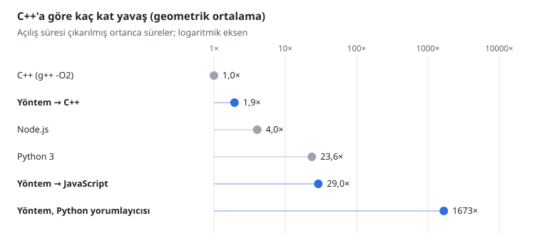

# Yöntem benchmark raporu

Tarih: 2026-11-09 01:17 · Tekrar: 7 (ısınmadan sonra, ortanca alındı)

| Ortam | Sürüm |
|---|---|
| Node.js | v22.23.4 |
| Python | 3.13.18 |
| C++ derleyicisi | g++ (Ubuntu 13.3.0-6ubuntu2~24.04.1) 13.3.0 |
| Yöntem | Yöntem 0.5.0 (JavaScript) |

İşletim sistemi: Linux 6.18.44-fc-v310 (x86_64)

## Geometrik ortalama: C++'a göre kaç kat yavaş

| Ortam | Kat |
|---|---|
| C++ (g++ -O2) | 1,0× |
| Yöntem → C++ | 1,9× |
| Node.js | 4,0× |
| Python 3 | 23,6× |
| Yöntem → JavaScript | 29,0× |
| Yöntem, Python yorumlayıcısı | 1673× |

## Ortanca süreler (açılış dahil)

| Test | Yöntem → C++ | Yöntem → JavaScript | Yöntem, Python yorumlayıcısı | C++ (g++ -O2) | Node.js | Python 3 |
|---|---|---|---|---|---|---|
| `bos` | 1,6 ms | 63,2 ms | 32,8 ms | 1,0 ms | 32,6 ms | 13,7 ms |
| `fannkuch` | 6,2 ms | 0,159 sn | 8,579 sn | 4,0 ms | 41,6 ms | 0,141 sn |
| `fib` | 3,1 ms | 81,1 ms | 3,432 sn | 1,4 ms | 36,5 ms | 36,8 ms |
| `ikili_agac` | 11,4 ms | 0,195 sn | 3,146 sn | 7,5 ms | 50,8 ms | 55,3 ms |
| `matris` | 5,1 ms | 0,153 sn | 7,181 sn | 2,5 ms | 42,0 ms | 0,165 sn |
| `nbody` | 13,6 ms | 0,269 sn | 13,991 sn | 3,0 ms | 41,8 ms | 0,209 sn |
| `siralama` | 7,6 ms | 0,154 sn | 4,484 sn | 5,2 ms | 51,0 ms | 63,1 ms |
| `sozcuk_sayma` | 10,7 ms | 0,119 sn | 0,699 sn | 8,4 ms | 56,4 ms | 37,7 ms |
| `spektral` | 6,2 ms | 0,142 sn | 7,703 sn | 2,7 ms | 42,5 ms | 89,3 ms |

## C++'a göre kat (açılış süresi çıkarılmış)

| Test | Yöntem → C++ | Yöntem → JavaScript | Yöntem, Python yorumlayıcısı | C++ (g++ -O2) | Node.js | Python 3 |
|---|---|---|---|---|---|---|
| `fannkuch` | 1,5× | 32,2× | 2859× | 1,0× | 3,0× | 42,6× |
| `fib` | 1,5× | 17,9× | 3399× | 1,0× | 3,9× | 23,1× |
| `ikili_agac` | 1,5× | 20,0× | 473× | 1,0× | 2,8× | 6,3× |
| `matris` | 2,3× | 59,4× | 4709× | 1,0× | 6,2× | 99,5× |
| `nbody` | 5,8× | 100× | 6783× | 1,0× | 4,5× | 95,1× |
| `siralama` | 1,4× | 21,5× | 1047× | 1,0× | 4,3× | 11,6× |
| `sozcuk_sayma` | 1,2× | 7,5× | 89,4× | 1,0× | 3,2× | 3,2× |
| `spektral` | 2,6× | 46,0× | 4456× | 1,0× | 5,7× | 43,9× |

## Testler

- `bos`: açılış süresi (boş program)
- `fannkuch`: fannkuch (N=8): tamsayı dizileri
- `fib`: özyinelemeli Fibonacci(27): fonksiyon çağrısı
- `ikili_agac`: tam ikili ağaçlar (derinlik 14): nesne oluşturma
- `matris`: 100×100 matris çarpımı: ondalık aritmetik, dizi erişimi
- `nbody`: beş cisim, 20000 adım: ondalık aritmetik
- `siralama`: 30000 sayıyı hızlı sıralama: karşılaştırma, takas
- `sozcuk_sayma`: 40000 sözcüğü sayma: metin ve sözlük
- `spektral`: spektral norm (N=120): fonksiyon çağrısı, ondalık

## Yöntem

- Her test her ortamda aynı algoritmayla yazılmıştır ve aynı çıktıyı vermek zorundadır; çıktısı `beklenen.txt` ile birebir aynı olmayan ölçüm geçersiz sayılır.
- Her ölçümden önce bir ısınma çalıştırması yapılır (dosya önbelleği, JIT derleyicisi).
- Süre, sürecin başlatılmasından bitişine kadar geçen duvar saati süresidir (açılış dahil).
- Oranlar için her ortamın `bos` testindeki açılış süresi çıkarılır; sonuç en az 1 ms sayılır, çünkü çok kısa sürelerde ölçüm gürültüsü baskın olur.
- Testlerin özeti olarak oranların geometrik ortalaması verilir; böylece tek bir test genel sonucu çarpıtmaz.
- C++ sürelerinin çoğu 10 ms'nin altındadır; bu sürelerde işletim sisteminden gelen gürültü oranları birkaç on yüzde oynatabilir. Daha kararlı sonuç için `--tekrar` artırılabilir.
